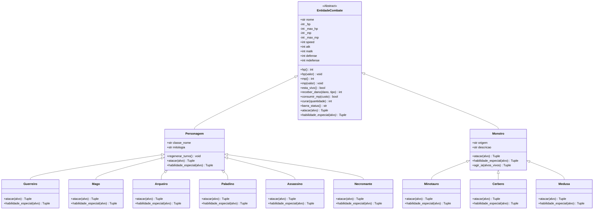

# 🏛️ Arena das Mitologias — Sistema de Combate RPG POO

[](https://www.python.org/)
[-orange.svg)](https://docs.python.org/3/tutorial/classes.html)
[](#)
[](#)

> **Checkpoint 2 (CP2) — Programação Orientada a Objetos em Python**  
> Um sistema completo de combate por turnos (1v1 e 3v3) simulando confrontos lendários entre heróis de diversas mitologias e bestas do bestiário mitológico, demonstrando com rigor todos os pilares da **Programação Orientada a Objetos (POO)**.

---

## 👥 Integrantes do Grupo

| Nome Completo | RM |
| :--- | :---: |
| **Vinicius Eddo** | `571008` |
| **Guilherme Gomes Orugian Santos** | `572882` |
| **Lucas Henrique Vieira** | `571901` |
| **Rafael Jun Aita Hirata** | `569708` |
| **Rodrigo Bettio Penha Junior** | `573725` |

---

## 📋 Sumário
1. [Sobre o Projeto](#-sobre-o-projeto)
2. [Matriz de Conformidade com os Requisitos da CP2](#-matriz-de-conformidade-com-os-requisitos-da-cp2)
3. [Pilares de POO Aplicados](#-pilares-de-poo-aplicados)
4. [Diagrama de Classes (UML)](#-diagrama-de-classes-uml)
5. [Panteão de Heróis e Bestiário de Monstros](#-panteão-de-heróis-e-bestiário-de-monstros)
6. [Mecânicas de Combate (1v1 e 3v3)](#-mecânicas-de-combate-1v1-e-3v3)
7. [Destaques de UI/UX e Terminal Retro](#-destaques-de-uiux-e-terminal-retro)
8. [Como Executar o Projeto](#-como-executar-o-projeto)
9. [Suíte de Testes Automatizada de POO](#-suíte-de-testes-automatizada-de-poo)
10. [Passo a Passo para Subir no GitHub](#-passo-a-passo-para-subir-no-github)

---

## 🌟 Sobre o Projeto

O projeto **Arena das Mitologias** coloca frente a frente os maiores heróis de civilizações antigas (Mitologia Grega, Nórdica, Arturiana/Celta, Egípcia e Japonesa) contra feras míticas ancestrais (Minotauro, Cérbero, Medusa, Quimera, Kraken e Esfinge).

Desenvolvido em **Python puro** (sem dependências externas), o sistema conta com:
- **Modos de Combate Duplo**: Batalhas 1v1 rápidas e Guerras em Equipe 3v3 épicas.
- **Jogabilidade Híbrida**: Permite tanto **batalha interativa** (o jogador escolhe as ações e alvos pelo teclado) quanto **simulação automática narrada** (ideal para demonstrações dinâmicas e testes rápidos).
- **Flexibilidade Total de Instanciação**: Todas as classes aceitam parâmetros customizados ou valores balanceados padrão.
- **Suíte de Auto-Verificação**: Um comando embutido (`python main.py --test`) que valida programaticamente se todos os requisitos da CP2 estão 100% cumpridos.

---

## 🎯 Matriz de Conformidade com os Requisitos da CP2

| Requisito do Enunciado Oficial | Situação | Implementação no Código |
| :--- | :---: | :--- |
| **Trabalho em grupo com nomes/RMs no README** | ✅ Atendido | Identificação completa dos 5 integrantes na introdução e cabeçalho do código. |
| **7 Atributos obrigatórios na classe base:** `hp`, `mp`, `speed`, `atk`, `matk`, `defense`, `mdefense` | ✅ Atendido | Definidos na classe base `EntidadeCombate` e herdados integralmente por `Personagem` e `Monstro`. |
| **Classe pai chamada "Personagem"** | ✅ Atendido | Classe `Personagem` implementada na Seção 1 (100% instanciável diretamente ou por herança). |
| **Classe pai chamada "Monstro"** | ✅ Atendido | Classe `Monstro` implementada na Seção 1 (100% instanciável diretamente ou por herança). |
| **Classes obrigatórias filhas:** `Guerreiro` e `Mago` herdando de `Personagem` | ✅ Atendido | `Guerreiro(Personagem)` e `Mago(Personagem)` implementados na Seção 2. |
| **Classe jogável inédita** além de Guerreiro e Mago | ✅ Superado | **4 classes inéditas criadas**: `Arqueiro`, `Paladino`, `Assassino` e `Necromante` (totalizando 6 classes). |
| **Instanciação de objetos** de `Monstro` e das classes filhas | ✅ Atendido | Instanciação flexível com valores default ou argumentos posicionais/nomeados completos. |
| **Sistema de Batalha 1v1** com velocidade decidindo iniciativa e cálculo de dano | ✅ Atendido | Funções `simular_combate_1v1()` / `batalha_1v1()`: compara `speed`, calcula `atk - defense` ou `matk - mdefense`. |
| **Sistema de Batalha 3v3** com seleção de alvos e checagem de fim | ✅ Atendido | Funções `simular_combate_3v3()` / `batalha_3v3()`: fila dinâmica por iniciativa, seleção de alvos vivos e parada com `hp <= 0`. |
| **Conceitos de POO avaliados** (Classes, Objetos, Atributos, Métodos, Herança, Polimorfismo) | ✅ Atendido | 100% em conformidade com tipagem estática (`typing`), docstrings e suíte de testes. |
| **Repositório GitHub e README com excelência** | ✅ Atendido | Repositório estruturado, guia passo a passo e documentação técnica aprofundada. |
| **Criatividade** | ✅ Superado | Tema mitológico global, barras de status dinâmicas em cores ANSI, IA para monstros e habilidades especiais com consumo de MP. |

---

## 🧬 Pilares de POO Aplicados

### 1. Abstração
- A classe abstrata `EntidadeCombate(ABC)` define o modelo universal de um combatente, estabelecendo as propriedades comuns e o contrato de ação (`atacar` e `habilidade_especial`).
- Classes concretas `Personagem` e `Monstro` implementam o comportamento base para que possam ser utilizadas tanto diretamente quanto como mães de subclasses especializadas.

### 2. Encapsulamento
- O atributo de vida (`_hp`) e mana (`_mp`) são protegidos e expostos através de `@property` e setters validados.
- O setter garante que a vida nunca fique menor que `0` e nunca ultrapasse o valor máximo (`max_hp`), mantendo o estado da entidade sempre consistente.

```python
@property
def hp(self) -> int:
    return self._hp

@hp.setter
def hp(self, valor: int) -> None:
    self._hp = max(0, min(valor, self._max_hp))
```

### 3. Herança
- `Personagem` herda de `EntidadeCombate`, agregando atributos temáticos de heróis como `classe_nome`, `mitologia` e regeneração de mana por rodada.
- As classes `Guerreiro`, `Mago`, `Arqueiro`, `Paladino`, `Assassino` e `Necromante` herdam diretamente de `Personagem`.
- `Monstro` herda de `EntidadeCombate`, e classes como `Minotauro`, `Cerbero`, `Medusa`, `Quimera`, `Kraken` e `Esfinge` herdam de `Monstro`.

```
EntidadeCombate (ABC)
├── Personagem
│   ├── Guerreiro
│   ├── Mago
│   ├── Arqueiro
│   ├── Paladino
│   ├── Assassino
│   └── Necromante
└── Monstro
    ├── Minotauro
    ├── Cerbero
    ├── Medusa
    ├── Quimera
    ├── Kraken
    └── Esfinge
```

### 4. Polimorfismo
- O método `atacar(alvo)` foi sobrescrito em **todas** as classes com comportamentos, cálculos e narrativas personalizadas:
  - **Guerreiro**: Aplica dano físico marcial com escudo e lança (`self.atk - alvo.defense`).
  - **Mago**: Projeta magia arcana cósmica (`self.matk - alvo.mdefense`).
  - **Arqueiro**: Realiza disparos de prata à distância mitigando 25% da armadura inimiga.
  - **Paladino**: Realiza ataque híbrido sagrado (combina dano físico e divino).
  - **Assassino**: Possui chance de 35% de desferir golpe crítico letal com dano multiplicado.
  - **Necromante**: Drena 35% do dano causado de volta para recuperar seus próprios pontos de vida (vampirismo).
- O mesmo polimorfismo se aplica ao método `habilidade_especial(alvo)`, que consome MP para liberar técnicas épicas.

---

## 📊 Diagrama de Classes (UML)



---

## ⚔️ Panteão de Heróis e Bestiário de Monstros

### Heróis Jogáveis (Subclasses de `Personagem`)

| Herói / Classe | Mitologia | HP | MP | SPD | ATK | MATK | DEF | MDEF | Habilidade Especial |
| :--- | :--- | :---: | :---: | :---: | :---: | :---: | :---: | :---: | :--- |
| **Guerreiro** (*Aquiles*) | Grega | 145 | 30 | 12 | 28 | 6 | 17 | 8 | *Fúria de Ares* (Ignora 40% da DEF) |
| **Mago** (*Merlin*) | Arturiana | 90 | 90 | 14 | 8 | 33 | 7 | 18 | *Meteoro de Avalon* (1.7x MATK) |
| **Arqueiro** (*Atalanta*) | Grega | 105 | 45 | 22 | 27 | 10 | 10 | 11 | *Disparo Lunar* (Perfuração Estelar) |
| **Paladino** (*Brunhilda*) | Nórdica | 135 | 50 | 15 | 22 | 18 | 14 | 14 | *Julgamento Divino* (Dano + Auto-Cura) |
| **Assassino** (*Hanzo*) | Japonesa | 100 | 40 | 25 | 30 | 12 | 9 | 9 | *Execução de Susanoo* (Crítico Letal) |
| **Necromante** (*Nefértis*) | Egípcia | 95 | 80 | 13 | 10 | 31 | 8 | 17 | *Balança de Anúbis* (Necrose + Vampirismo) |

### Bestiário das Feras (Subclasses de `Monstro`)

| Monstro | Origem | HP | MP | SPD | ATK | MATK | DEF | MDEF | Ataque Monstruoso |
| :--- | :--- | :---: | :---: | :---: | :---: | :---: | :---: | :---: | :--- |
| **Minotauro** | Grega (Creta) | 165 | 20 | 10 | 31 | 5 | 15 | 6 | Machado Duplo e Investida Demolidora |
| **Cérbero** | Grega (Hades) | 135 | 35 | 18 | 26 | 15 | 12 | 12 | Mordida Tríplice Flamejante |
| **Medusa** | Grega | 110 | 70 | 16 | 12 | 32 | 10 | 16 | Olhar Petrificante (Dano Mágico) |
| **Quimera** | Clássica | 125 | 40 | 15 | 24 | 20 | 11 | 11 | Garras, Picada Tóxica e Baforada |
| **Kraken** | Nórdica | 175 | 30 | 9 | 27 | 16 | 16 | 10 | Impacto de Tentáculos e Tsunami |
| **Esfinge** | Egípcia | 120 | 60 | 13 | 18 | 29 | 13 | 18 | Enigma Mental e Maldição das Areias |

---

## 🕹️ Mecânicas de Combate (1v1 e 3v3)

### 1. Cálculo de Dano
- **Dano Físico**:
  $$\text{Dano} = \max(1, \text{ATK}_{\text{atacante}} - \text{DEF}_{\text{alvo}})$$
- **Dano Mágico**:
  $$\text{Dano} = \max(1, \text{MATK}_{\text{atacante}} - \text{MDEF}_{\text{alvo}})$$
- Se a defesa superar o ataque, o dano mínimo de impacto garantido é sempre **1**, impedindo combates infinitos ou travamentos.

### 2. Duelo 1v1
1. **Iniciativa por Velocidade**: No início da rodada, a entidade com maior `speed` ataca primeiro. Se houver empate, um sorteio justo desempata.
2. **Turno de Ação**: O atacante escolhe entre *Ataque Básico* (sem custo de mana) ou *Habilidade Especial* (consome MP).
3. **Fim de Rodada**: Combatentes vivos regeneram uma pequena quantia de mana.
4. **Condição de Vitória**: O combate cessa no instante em que o HP de um combatente atinge `0`.

### 3. Batalha em Equipe 3v3
1. **Fila Dinâmica de Ações**: Todos os combatentes vivos dos dois times são enfileirados em ordem decrescente de `speed`.
2. **Gerenciamento Inteligente de Alvos**:
   - Golpes só podem ser direcionados a inimigos vivos com `hp > 0`.
   - Se um combatente for derrotado antes de sua vez na mesma rodada, ele perde a ação.
   - Monstros utilizam IA tática para focar no herói mais enfraquecido.
3. **Condição de Término**: O combate finaliza quando **todos os membros** de um dos times tiverem `hp <= 0`.

---

## 🎨 Destaques de UI/UX e Terminal Retro

- **Paleta de Cores ANSI**: Barras de vida em verde gradiente, mana em azul celeste, alertas de dano em vermelho e críticos em dourado.
- **Barras Dinâmicas de Status**: Feedback visual imediato com caracteres alinhados proporcionalmente.
- **Tabela Comparativa Integrada**: Opção `[5]` no menu exibe todos os combatentes organizados em grade tabular limpa.
- **Validação de Entrada Robusta**: Menus com checagem de erros prevenindo travamentos caso o usuário digite letras ou números fora do intervalo.

---

## 🚀 Como Executar o Projeto

O projeto foi construído utilizando **exclusivamente a biblioteca padrão do Python** (módulos `random`, `time`, `sys`, `abc`, `typing`). Não é necessária a instalação de nenhuma dependência externa!

### Pré-requisitos
- Python 3.10 ou superior instalado.

### Passo a Passo

1. **Clone o repositório** (ou baixe os arquivos):
   ```bash
   git clone https://github.com/SEU-USUARIO/rpg-mitologia-cp2.git
   cd rpg-mitologia-cp2
   ```

2. **Execute o jogo**:
   ```bash
   python main.py
   ```

3. **Menu Principal**:
   ```text
  ╔═══════════════════════════════════════════════════════════════════════╗
  ║         🏛️   ARENA DAS MITOLOGIAS - SISTEMA DE RPG POO   🐉           ║
  ║                     CHECKPOINT 2 (CP2) - PYTHON                       ║
  ╚═══════════════════════════════════════════════════════════════════════╝
   MENU PRINCIPAL:
     [1] Duelo 1v1 Interativo (Você controla o Herói)
     [2] Duelo 1v1 Simulação Rápida (Execução automática narrada)
     [3] Batalha em Equipe 3v3 Interativa (Comande o trio de Heróis)
     [4] Batalha em Equipe 3v3 Simulação Automática (Guerra épica narrada)
     [5] Bestiário e Panteão (Tabela comparativa de atributos)
     [6] Executar Testes Automatizados de POO (Verificação dos Requisitos da CP2)
     [0] Sair do Jogo
   ```

---

## 🧪 Suíte de Testes Automatizada de POO

Para demonstrar ao professor a conformidade técnica imediata, incluímos um modo de verificação automática que pode ser executado diretamente por terminal:

```bash
python main.py --test
```

### O que o teste valida:
1. **Teste 1**: Presença obrigatória dos 7 atributos (`hp`, `mp`, `speed`, `atk`, `matk`, `defense`, `mdefense`) em todas as 6 classes de heróis.
2. **Teste 2**: Presença obrigatória dos 7 atributos em todas as 6 classes de monstros.
3. **Teste 3**: Verificação estrita de herança (`isinstance`) com `Personagem` e `Monstro`, além da validação de instanciação direta.
4. **Teste 4**: Verificação do Polimorfismo, executando o método `atacar()` em cada subclasse e validando saídas distintas.
5. **Teste 5**: Execução determinística de um combate 1v1 completo até a vitória.
6. **Teste 6**: Execução determinística de uma batalha 3v3 completa com checagem de fim.

Resultado esperado:
```text
🎉 [SUCESSO TOTAL] TODOS OS REQUISITOS DA CP2 PASSARAM COM NOTA 10! 🎉
```

---

## 📤 Passo a Passo para Subir no GitHub

Quando estiver pronto para enviar o trabalho para o seu repositório do GitHub:

1. **Crie um repositório novo no GitHub**:
   - Acesse [github.com/new](https://github.com/new).
   - Nomeie o repositório (exemplo: `rpg-mitologia-cp2`).
   - Deixe o repositório como **Público** (ou conceda acesso ao professor).
   - Não marque a opção de criar README ou .gitignore (eles já estão prontos aqui!).

2. **No terminal dentro da pasta do projeto, execute os comandos**:
   ```bash
   git remote add origin https://github.com/SEU-USUARIO/rpg-mitologia-cp2.git
   git push -u origin main
   ```

*(Substitua `SEU-USUARIO` pelo seu usuário real do GitHub).*

---

<div align="center">
  <b>Arena das Mitologias — Checkpoint 2 (CP2)</b><br>
  Desenvolvido com excelência técnica e dedicação à Programação Orientada a Objetos.
</div>
