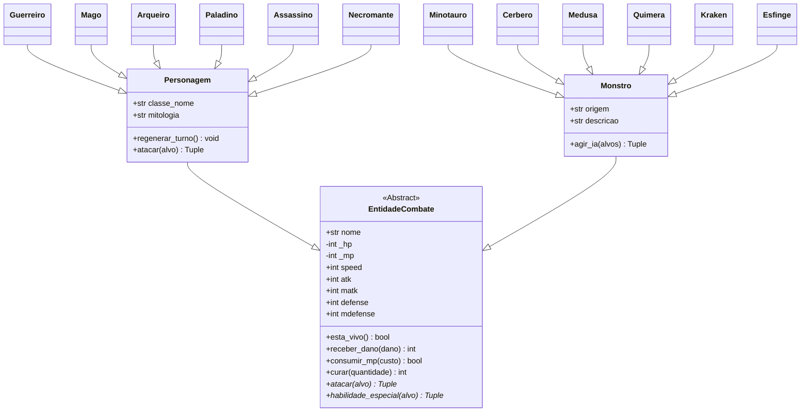

# 🏛️ Arena das Mitologias — Sistema de Combate RPG POO

[](https://www.python.org/)
[-orange.svg)](https://docs.python.org/3/tutorial/classes.html)
[](#)
[](#)

> **Checkpoint 2 (CP2) — Programação Orientada a Objetos em Python**  
> Sistema de combate RPG por turnos (1v1 e 3v3) simulando confrontos entre heróis de diversas mitologias e criaturas lendárias, estruturado com foco nos conceitos fundamentais de **Programação Orientada a Objetos (POO)**.

---

## 👥 Integrantes do Grupo

| Nome Completo | RM |
| :--- | :---: |
| **Vinicius Eddo** | `571008` |
| **Guilherme Gomes Orugian Santos** | `572882` |
| **Lucas Henrique Vieira** | `571901` |
| **Rafael Jun Aita Hirata** | `569708` |
| **Rodrigo Bettio Penha Junior** | `573725` |

---

## 📋 Sumário
1. [Sobre o Projeto](#-sobre-o-projeto)
2. [Conformidade com os Requisitos da CP2](#-conformidade-com-os-requisitos-da-cp2)
3. [Pilares de POO Aplicados](#-pilares-de-poo-aplicados)
4. [Diagrama de Classes (UML)](#-diagrama-de-classes-uml)
5. [Panteão de Heróis e Bestiário de Monstros](#-panteão-de-heróis-e-bestiário-de-monstros)
6. [Mecânicas de Combate (1v1 e 3v3)](#-mecânicas-de-combate-1v1-e-3v3)
7. [Como Executar o Projeto](#-como-executar-o-projeto)
8. [Passo a Passo para Subir no GitHub](#-passo-a-passo-para-subir-no-github)

---

## 🌟 Sobre o Projeto

O projeto **Arena das Mitologias** simula batalhas táticas entre lendas de várias culturas (Grega, Nórdica, Arturiana, Egípcia e Japonesa) contra bestas mitológicas consagradas (Minotauro, Cérbero, Medusa, Quimera, Kraken e Esfinge).

Desenvolvido em **Python puro** (sem dependências externas):
- **Combates 1v1 e 3v3**: Duelos rápidos e guerras completas em equipe.
- **Modos Interativo e Simulação**: O usuário pode comandar cada ação manualmente ou assistir a uma simulação com narração dos turnos.
- **Código Limpo e Modular**: Classes com responsabilidades bem definidas, tipagem e encapsulamento.

---

## 🎯 Conformidade com os Requisitos da CP2

| Requisito | Situação | Detalhes |
| :--- | :---: | :--- |
| **Identificação do grupo no README** | ✅ Concluído | Tabela com nome e RM dos 5 integrantes. |
| **7 Atributos obrigatórios na base:** `hp`, `mp`, `speed`, `atk`, `matk`, `defense`, `mdefense` | ✅ Concluído | Presentes em todos os heróis e monstros através da classe base. |
| **Classe mãe "Personagem"** | ✅ Concluído | Implementada com método base de ataque e regeneração de mana. |
| **Classe mãe "Monstro"** | ✅ Concluído | Implementada com método base de ataque e IA de tomada de decisão. |
| **Classes obrigatórias "Guerreiro" e "Mago" herdando de Personagem** | ✅ Concluído | Ambas herdando de `Personagem` com atributos balanceados e sobrescrita de ataque. |
| **Classes jogáveis inéditas** | ✅ Concluído | 4 classes inéditas adicionadas: `Arqueiro`, `Paladino`, `Assassino` e `Necromante`. |
| **Instanciação de objetos** | ✅ Concluído | Instâncias disponíveis nas fábricas e nos menus de batalha. |
| **Batalha 1v1** com velocidade e cálculo de dano | ✅ Concluído | `simular_combate_1v1` decide turnos por `speed` e calcula dano com base na defesa. |
| **Batalha 3v3** com seleção de alvos e condição de vitória | ✅ Concluído | `simular_combate_3v3` gerencia alvos vivos e encerra quando um time tem `hp <= 0`. |
| **Conceitos de POO aplicados** | ✅ Concluído | Classes, herança, polimorfismo, encapsulamento e propriedades. |

---

## 🧬 Pilares de POO Aplicados

### 1. Abstração e Encapsulamento
- As propriedades `hp` e `mp` são protegidas com `@property` e setters, garantindo que o HP nunca fique abaixo de zero nem exceda a vida máxima.
- A abstração `EntidadeCombate` padroniza o contrato de combate (`atacar` e `habilidade_especial`).

### 2. Herança
- `Personagem` herda de `EntidadeCombate` e serve de classe mãe para `Guerreiro`, `Mago`, `Arqueiro`, `Paladino`, `Assassino` e `Necromante`.
- `Monstro` herda de `EntidadeCombate` e serve de classe mãe para `Minotauro`, `Cerbero`, `Medusa`, `Quimera`, `Kraken` e `Esfinge`.

### 3. Polimorfismo
- Cada subclasse sobrescreve o método `atacar(alvo)` com fórmulas e narrativas específicas:
  - **Guerreiro**: Dano físico clássico mitigado por armadura (`atk - defense`).
  - **Mago**: Projéteis mágicos confrontando defesa mágica (`matk - mdefense`).
  - **Arqueiro**: Flechas com perfuração que ignoram 25% da armadura inimiga.
  - **Paladino**: Ataque híbrido sagrado (dano físico + luminoso).
  - **Assassino**: Chance de 35% de golpe crítico com dano aumentado.
  - **Necromante**: Dano necrótico com vampirismo (recupera parte do dano como vida).
- As subclasses também implementam `habilidade_especial(alvo)` consumindo mana (MP).

---

## 📊 Diagrama de Classes (UML)



---

## ⚔️ Panteão de Heróis e Bestiário de Monstros

### Heróis

| Classe | Herói | Mitologia | HP | MP | SPD | ATK | MATK | DEF | MDEF |
| :--- | :--- | :--- | :---: | :---: | :---: | :---: | :---: | :---: | :---: |
| **Guerreiro** | Aquiles | Grega | 145 | 30 | 12 | 28 | 6 | 17 | 8 |
| **Mago** | Merlin | Arturiana | 90 | 90 | 14 | 8 | 33 | 7 | 18 |
| **Arqueiro** | Atalanta | Grega | 105 | 45 | 22 | 27 | 10 | 10 | 11 |
| **Paladino** | Brunhilda | Nórdica | 135 | 50 | 15 | 22 | 18 | 14 | 14 |
| **Assassino** | Hanzo | Japonesa | 100 | 40 | 25 | 30 | 12 | 9 | 9 |
| **Necromante** | Nefértis | Egípcia | 95 | 80 | 13 | 10 | 31 | 8 | 17 |

### Monstros

| Monstro | Origem | HP | MP | SPD | ATK | MATK | DEF | MDEF |
| :--- | :--- | :---: | :---: | :---: | :---: | :---: | :---: | :---: |
| **Minotauro** | Mitologia Grega | 165 | 20 | 10 | 31 | 5 | 15 | 6 |
| **Cérbero** | Mitologia Grega | 135 | 35 | 18 | 26 | 15 | 12 | 12 |
| **Medusa** | Mitologia Grega | 110 | 70 | 16 | 12 | 32 | 10 | 16 |
| **Quimera** | Mitologia Clássica | 125 | 40 | 15 | 24 | 20 | 11 | 11 |
| **Kraken** | Mitologia Nórdica | 175 | 30 | 9 | 27 | 16 | 16 | 10 |
| **Esfinge** | Mitologia Egípcia | 120 | 60 | 13 | 18 | 29 | 13 | 18 |

---

## 🕹️ Mecânicas de Combate (1v1 e 3v3)

1. **Iniciativa**: A cada rodada, o combatente com maior `speed` ataca primeiro. Em caso de empate, um sorteio justo desempata.
2. **Cálculo de Dano**:
   - Dano físico: `max(1, atacante.atk - alvo.defense)`
   - Dano mágico: `max(1, atacante.matk - alvo.mdefense)`
3. **Condição de Término**:
   - No 1v1, a batalha encerra assim que o HP de um dos duelistas atinge 0.
   - No 3v3, encerra quando todos os 3 combatentes de uma equipe ficarem com `hp <= 0`.

---

## 🚀 Como Executar o Projeto

O projeto utiliza apenas módulos padrão do Python (`sys`, `time`, `random`, `abc`, `typing`).

```bash
# Executa o jogo interativo
python main.py
```

### Menu Principal
```text
  ╔═══════════════════════════════════════════════════════════════════════╗
  ║            ARENA DAS MITOLOGIAS - SISTEMA DE RPG (CP2)                ║
  ╚═══════════════════════════════════════════════════════════════════════╝
MENU PRINCIPAL:
  [1] Duelo 1v1 Interativo (Você controla o Herói)
  [2] Duelo 1v1 Simulação Rápida (Execução automática narrada)
  [3] Batalha em Equipe 3v3 Interativa (Comande os 3 Heróis)
  [4] Batalha em Equipe 3v3 Simulação Rápida (Guerra épica narrada)
  [5] Panteão e Bestiário (Ver atributos de todos os combatentes)
  [0] Sair do Jogo
```

---

## 📤 Passo a Passo para Subir no GitHub

1. Crie um repositório vazio no [GitHub](https://github.com/new) (ex: `rpg-mitologia-cp2`).
2. No terminal, dentro da pasta do projeto, execute:
   ```bash
   git remote add origin https://github.com/SEU-USUARIO/rpg-mitologia-cp2.git
   git push -u origin main
   ```
*(Substitua `SEU-USUARIO` pelo seu usuário do GitHub).*
